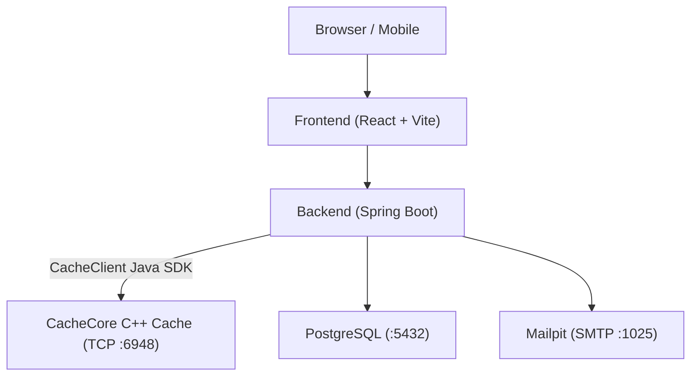

# atomURL

A self-hosted URL shortener with real-time click analytics, user authentication, and an end-to-end custom caching architecture.

## Architecture

atomURL is designed as a distributed system built from scratch, including its own custom caching infrastructure rather than third-party solutions:

- **Frontend**: React 19 + Vite (Vanilla CSS)
- **Backend**: Spring Boot 3 (Java 25)
- **Custom Cache Client**: [CacheClient](https://github.com/guru-jadhav/CacheClient) — Custom Java driver built to communicate with CacheCore over raw TCP sockets.
- **Custom In-Memory Cache**: [CacheCore](https://github.com/guru-jadhav/CacheCore) — Custom in-memory key-value cache server written in C++ (Docker: `gurujadhav471/cachecore`, port 6948).
- **Database**: PostgreSQL 15 (relational persistence & Flyway migrations)
- **Email**: Mailpit (local SMTP for email OTP verification in development)
- **Auth**: Stateless JWTs with Email OTP and Google & GitHub OAuth2



## End-to-End System Design (Custom Cache Stack)

Most applications plug in Redis or Memcached out of the box. To demonstrate low-level systems and protocol design alongside application engineering, atomURL uses a custom-built caching ecosystem:

1. **[CacheCore (C++)](https://github.com/guru-jadhav/CacheCore)**: Standalone in-memory TCP cache daemon written in C++. Handles low-latency key-value storage and runs containerized alongside the app.
2. **[CacheClient (Java)](https://github.com/guru-jadhav/CacheClient)**: Published Java SDK (`com.github.guru-jadhav:CacheClient`) that handles connection pooling, TCP socket communication, and command serialization for the Spring Boot backend.
3. **atomURL (Full-Stack Service)**: The production consumer tying together the C++ cache daemon, the Java client library, PostgreSQL persistence, and the React frontend.

## Features

- **Link Shortening & Redirection**: Encodes sequential database IDs into Base62 short codes. Redirects check CacheCore first before querying PostgreSQL.
- **Click Analytics**: Tracks clicks per link over time (last 30 days) with interactive daily charts.
- **Cursor Pagination**: Dashboard links load sequentially with keyset pagination (`after` cursor + `limit`).
- **Authentication**: Passwordless Email OTP, plus Google and GitHub OAuth.
- **Clean UI**: Custom dark and light themes with responsive mobile layout and custom scrollbars.

## Tech Stack

- **Backend**: Java 25, Spring Boot 3, Spring Data JPA, Flyway
- **Caching**: [CacheCore](https://github.com/guru-jadhav/CacheCore) (C++ TCP daemon) & [CacheClient](https://github.com/guru-jadhav/CacheClient) (Java driver)
- **Frontend**: React 19, Vite, Vanilla CSS, Lucide React
- **Datastores & Infra**: PostgreSQL 15, Docker Compose, Mailpit

## Getting Started

### 1. Prerequisites
- Java 25 SDK
- Node.js 18+ & npm
- Docker & Docker Compose

### 2. Environment Variables
Create a `.env` file in the project root:

```env
# GitHub OAuth
GITHUB_CLIENT_ID=your_github_client_id
GITHUB_CLIENT_SECRET=your_github_client_secret
GITHUB_REDIRECT_URI=http://localhost:8080/api/auth/oauth/github/callback

# Google OAuth
GOOGLE_CLIENT_ID=your_google_client_id
GOOGLE_CLIENT_SECRET=your_google_client_secret
GOOGLE_REDIRECT_URI=http://localhost:8080/api/auth/oauth/google/callback

# JWT & Frontend URL
JWT_SECRET=your_256_bit_secret_key_here
FRONTEND_REDIRECT_URL=http://localhost:3000/auth/callback
CORS_ALLOWED_ORIGINS=http://localhost:3000
```

### 3. Start Infrastructure
Run PostgreSQL, CacheCore, and Mailpit via Docker:

```bash
docker compose up -d db cachecore mailpit
```
- PostgreSQL: `localhost:5432`
- CacheCore: `localhost:6948`
- Mailpit Web UI: `http://localhost:8025`

### 4. Run the Backend
```bash
cd backend
./mvnw spring-boot:run
```
Backend runs on `http://localhost:8080`.

### 5. Run the Frontend
```bash
cd frontend
npm install
npm run dev
```
Frontend runs on `http://localhost:3000`.

## API Overview

| Method | Endpoint | Description | Auth |
| :--- | :--- | :--- | :---: |
| `POST` | `/api/urls` | Create short URL | Optional |
| `GET` | `/{shortCode}` | Redirect to destination | No |
| `DELETE` | `/api/urls/{shortCode}` | Delete link & analytics | Yes |
| `GET` | `/api/user/urls` | Keyset paginated user links (`after`, `limit`) | Yes |
| `GET` | `/api/analytical/{code}` | 30-day click breakdown | No |
| `POST` | `/api/auth/send-otp` | Send email login code | No |
| `POST` | `/api/auth/validate-otp` | Verify OTP and return JWT | No |
| `GET` | `/api/auth/oauth/{provider}/login` | Start OAuth login flow | No |
| `GET` | `/api/user/profile` | Get current user profile | Yes |
| `PATCH`| `/api/user/profile/update-name` | Update display name | Yes |
