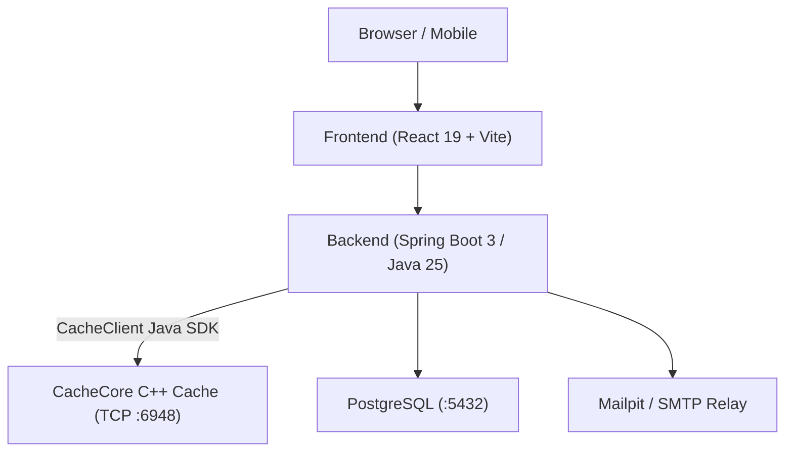

# atomURL

A self-hosted URL shortener with real-time click analytics, user authentication, an end-to-end custom caching architecture, and a comprehensive live admin telemetry console.

## Architecture

atomURL is designed as a distributed system built from scratch, including its own custom caching infrastructure rather than third-party solutions:

- **Frontend**: React 19 + Vite (Vanilla CSS, custom design system)
- **Backend**: Spring Boot 3 (Java 25)
- **Custom Cache Client**: [CacheClient](https://github.com/guru-jadhav/CacheClient) — Custom Java driver built to communicate with CacheCore over raw TCP sockets.
- **Custom In-Memory Cache**: [CacheCore](https://github.com/guru-jadhav/CacheCore) — Custom in-memory key-value cache server written in C++ (Docker: `gurujadhav471/cachecore`, port 6948).
- **Database**: PostgreSQL 15 (relational persistence & Flyway migrations)
- **Email**: Mailpit (local SMTP for email OTP verification in development) / SMTP relay in production
- **Auth & Security**: Stateless JWTs with Email OTP, Google & GitHub OAuth2, and instant token revocation via `token_version`



## End-to-End System Design (Custom Cache Stack)

Most applications plug in Redis or Memcached out of the box. To demonstrate low-level systems and protocol design alongside application engineering, atomURL uses a custom-built caching ecosystem:

1. **[CacheCore (C++)](https://github.com/guru-jadhav/CacheCore)**: Standalone in-memory TCP cache daemon written in C++. Handles low-latency key-value storage, rate limiting counters, and health pings (`PING`), running containerized alongside the application.
2. **[CacheClient (Java)](https://github.com/guru-jadhav/CacheClient)**: Published Java SDK (`com.github.guru-jadhav:CacheClient`) that handles connection pooling, TCP socket communication, and command serialization for the Spring Boot backend.
3. **atomURL (Full-Stack Service)**: The production consumer tying together the C++ cache daemon, the Java client library, PostgreSQL persistence, and the React frontend.

## Features

- **Link Shortening & Redirection**: Encodes sequential database IDs into Base62 short codes. Redirects check CacheCore first before querying PostgreSQL.
- **High-Performance Rate Limiting**: TCP-level request throttling backed by CacheCore counters to protect against brute-force attacks and API exhaustion.
- **Click Analytics**: Tracks clicks per link over time (last 30 days) with interactive daily charts and telemetry inspection.
- **Cursor Pagination**: Dashboard links load smoothly with keyset pagination (`after` cursor + `limit`) to avoid offset query degradation.
- **Authentication & Instant Token Revocation**:
  - Passwordless Email OTP, plus Google and GitHub OAuth.
  - Multi-session token revocation via database-backed `token_version`: changing sensitive credentials (like email) immediately invalidates active JWTs across all devices without maintaining a token blacklist.
- **Admin Console & Telemetry**:
  - Live infrastructure health diagnostics: PostgreSQL connection latency, CacheCore status via native RESP `PING()`, and SMTP mailer availability.
  - Real-time platform usage metrics: total URLs, click counters, registered users, and JVM heap memory utilization.
  - Paginated user directory with search and login provider tracking.
  - In-memory system error buffer capturing the 100 most recent service exceptions with on-demand refresh and manual purge.
- **Resilient UI/UX**:
  - Dark and light theme modes with custom scrollbars and a responsive mobile layout.
  - Automatic 7-day token expiration handling with seamless fallback to guest view.
  - Tab state persistence across page reloads with flicker-free role-based routing.
  - Cascading render and request guards with disabled button feedback (`cursor: not-allowed`) during active API calls.

## Tech Stack

- **Backend**: Java 25, Spring Boot 3, Spring Data JPA, Flyway, Spring Security
- **Caching**: [CacheCore](https://github.com/guru-jadhav/CacheCore) (C++ TCP daemon) & [CacheClient](https://github.com/guru-jadhav/CacheClient) (Java driver)
- **Frontend**: React 19, Vite, Vanilla CSS, Lucide React
- **Datastores & Infra**: PostgreSQL 15, Docker Compose, Mailpit

## Getting Started

### 1. Prerequisites
- Java 25 SDK
- Node.js 18+ & npm
- Docker & Docker Compose

### 2. Environment Variables

Create your `.env` file in the project root from the provided template:

```bash
cp .env.example .env
```

> **One-Command Setup (Local Dev):** Automatically copy the template and generate a cryptographically secure 256-bit JWT secret:
> ```bash
> cp .env.example .env && sed -i "s|your-secure-jwt-secret-key-must-be-at-least-32-chars|$(openssl rand -base64 32)|" .env
> ```

Key variables defined in `.env`:

```env
# --- Database & CacheCore ---
DB_HOST=localhost
DB_PORT=5432
DB_USERNAME=atomuser
DB_PASSWORD=atompassword
CACHECORE_DOMAIN=localhost
CACHECORE_PORT=6948

# --- Admin Emails (Comma-separated list) ---
ADMIN_EMAILS=admin@example.com

# --- JWT Authentication (Min 32 characters / 256-bit secret) ---
JWT_SECRET=your-secure-jwt-secret-key-must-be-at-least-32-chars

# --- Frontend & CORS ---
FRONTEND_REDIRECT_URL=http://localhost:3000/auth/callback
CORS_ALLOWED_ORIGINS=http://localhost:3000

# --- Email Delivery (Default points to local Mailpit container) ---
# For local dev with Mailpit:
MAIL_HOST=localhost
MAIL_PORT=1025
MAIL_SMTP_AUTH=false
MAIL_SMTP_STARTTLS=false

# For production / Brevo SMTP:
# MAIL_HOST=smtp-relay.brevo.com
# MAIL_PORT=587
# MAIL_USERNAME=your-brevo-login@smtp-brevo.com
# MAIL_PASSWORD=your-brevo-master-key
# MAIL_SMTP_AUTH=true
# MAIL_SMTP_STARTTLS=true

# --- OAuth 2.0 (Optional - required only for Google/GitHub sign-in) ---
GITHUB_CLIENT_ID=your_github_client_id
GITHUB_CLIENT_SECRET=your_github_client_secret
GITHUB_REDIRECT_URI=http://localhost:8080/api/auth/oauth/github/callback

GOOGLE_CLIENT_ID=your_google_client_id
GOOGLE_CLIENT_SECRET=your_google_client_secret
GOOGLE_REDIRECT_URI=http://localhost:8080/api/auth/oauth/google/callback
```

### 3. Start Infrastructure
Run PostgreSQL, CacheCore, and Mailpit via Docker:

```bash
docker compose up -d db cachecore mailpit
```
- PostgreSQL: `localhost:5432`
- CacheCore: `localhost:6948`
- Mailpit Web UI: `http://localhost:8025`

### 4. Run the Backend (with .env loaded)

Load the environment variables from your `.env` file and launch Spring Boot:

```bash
cd backend
set -a && source ../.env && set +a && ./mvnw spring-boot:run
```

*(Or run directly from the project root in one line)*:
```bash
set -a && source .env && set +a && cd backend && ./mvnw spring-boot:run
```

Backend runs on `http://localhost:8080`.

### 5. Run the Frontend
```bash
cd frontend
npm install
npm run dev
```
Frontend runs on `http://localhost:3000`.

## API Overview

| Method | Endpoint | Description | Auth |
| :--- | :--- | :--- | :---: |
| `POST` | `/api/urls` | Create short URL | Optional |
| `GET` | `/{shortCode}` | Redirect to destination & record click | No |
| `DELETE` | `/api/urls/{shortCode}` | Delete link, cache entry & analytics | Yes |
| `GET` | `/api/user/urls` | Keyset paginated user links (`after`, `limit`) | Yes |
| `GET` | `/api/analytical/{code}` | 30-day click breakdown | No |
| `POST` | `/api/auth/send-otp` | Send email login OTP code | No |
| `POST` | `/api/auth/validate-otp` | Verify OTP and return JWT with `token_version` | No |
| `GET` | `/api/auth/oauth/{provider}/login` | Initiate OAuth login flow (Google / GitHub) | No |
| `GET` | `/api/user/profile` | Get current authenticated user profile | Yes |
| `PATCH`| `/api/user/profile/update-name` | Update user display name | Yes |
| `POST` | `/api/user/profile/send-email-otp` | Send OTP for email address change | Yes |
| `PATCH`| `/api/user/profile/update-email` | Verify OTP, update email, increment `token_version` & issue new JWT | Yes |
| `GET` | `/api/admin/overview` | Live health checks (Postgres, CacheCore PING, SMTP) & platform telemetry | Admin |
| `GET` | `/api/admin/users` | Paginated platform user directory with search (`query`, `page`, `limit`) | Admin |
| `GET` | `/api/admin/errors` | In-memory system error buffer (recent 100 entries) | Admin |
| `DELETE`| `/api/admin/errors` | Clear in-memory error buffer | Admin |
